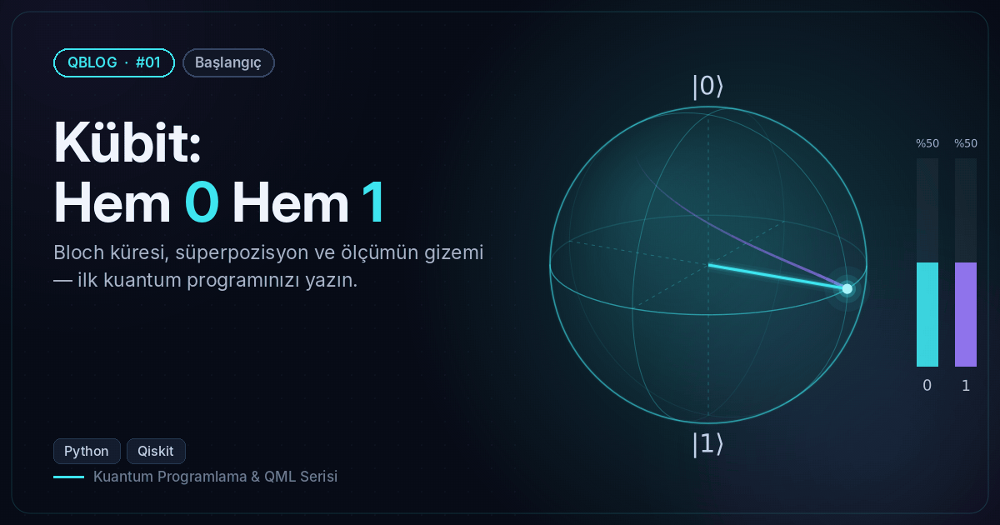
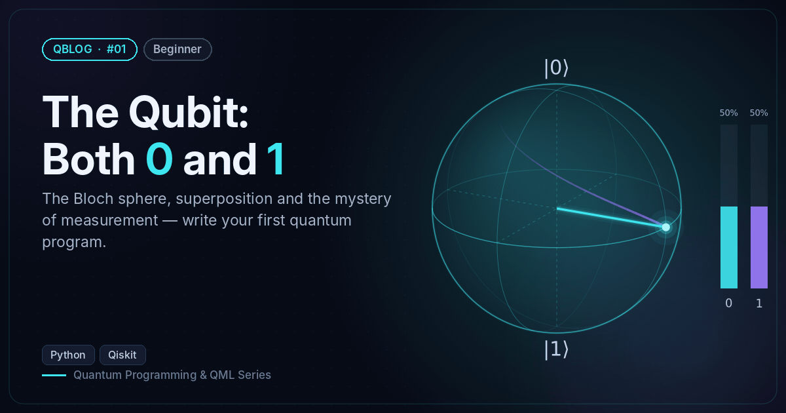

# #01 — Kübit: Hem 0 Hem 1 / The Qubit: Both 0 and 1

 

🇹🇷 Tek kübiti H kapısıyla süperpozisyona sokar, Bloch vektörünü hesaplar, 1000 kez ölçer ve Ry(θ) ile olasılıkları ayarlar.
🇬🇧 Puts one qubit into superposition with H, computes its Bloch vector, measures it 1000 times and tunes probabilities with Ry(θ).

```bash
python qubit_superposition.py
```

**Örnek çıktı / Sample output**

```
Devre / Circuit:
Durum vektörü / State vector: [0.707+0.j 0.707+0.j]
Olasılıklar / Probabilities: {np.str_('0'): 0.5, np.str_('1'): 0.5}
Bloch vektörü / Bloch vector: [1. 0. 0.]
1000 ölçüm / 1000 shots: {'1': 486, '0': 514}
 θ (derece/deg) | P(0)  | P(1)
             0 | 1.000 | 0.000
            30 | 0.933 | 0.067
            60 | 0.750 | 0.250
            90 | 0.500 | 0.500
           120 | 0.250 | 0.750
           150 | 0.067 | 0.933
           180 | 0.000 | 1.000
Görseller kaydedildi / Figures saved → /home/claude/QBlog/01-qubit/output
```
