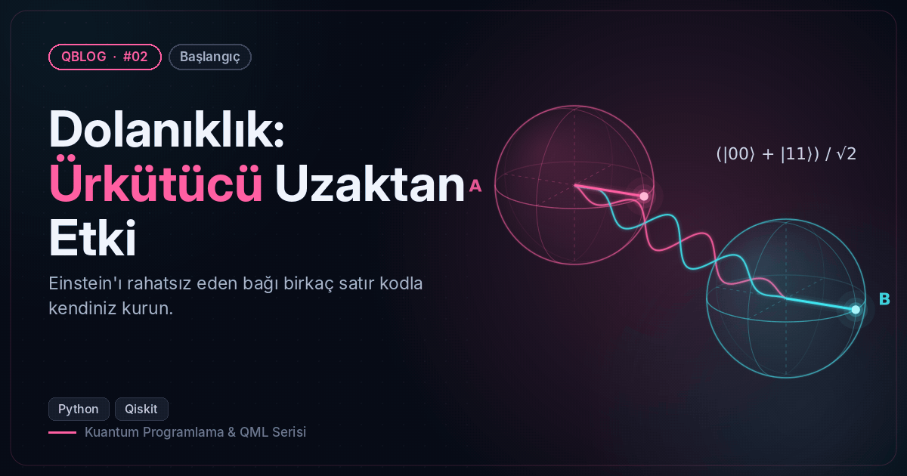
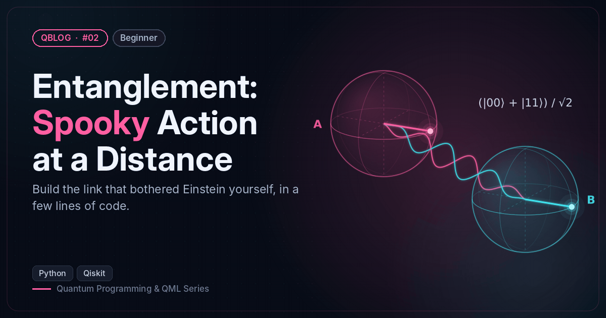

# #02 — Dolanıklık: Ürkütücü Uzaktan Etki / Entanglement: Spooky Action at a Distance

 

🇹🇷 Dört Bell durumunu kurar; tek kübitin tamamen rastgele, çiftin ise her zaman uyumlu olduğunu gösterir.
🇬🇧 Builds all four Bell states and shows that each qubit alone is pure noise while the pair always agrees.

```bash
python bell_states.py
```

**Örnek çıktı / Sample output**

```
Φ+ durumu / state: [0.70710678+0.j,0.        +0.j,0.        +0.j,0.70710678+0.j]
2000 ölçüm / shots: {'11': 1019, '00': 981}
Kübit A'nın yoğunluk matrisi / Qubit A density matrix:
 [[0.5 0. ]
 [0.  0.5]]
Dolanıklık entropisi / Entanglement entropy (bit): 1.0
Durum | Ölçümler / Measurements
  Φ+  | {'00': 489, '11': 511}
  Φ-  | {'00': 514, '11': 486}
  Ψ+  | {'01': 511, '10': 489}
  Ψ-  | {'01': 514, '10': 486}
X tabanında Φ+ / Φ+ in X basis: {'11': 1019, '00': 981}
```
