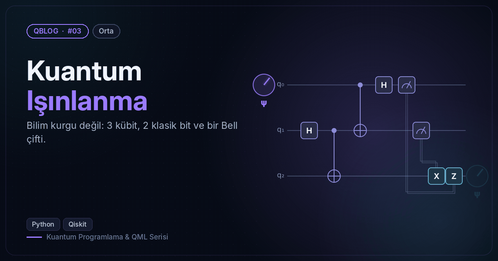
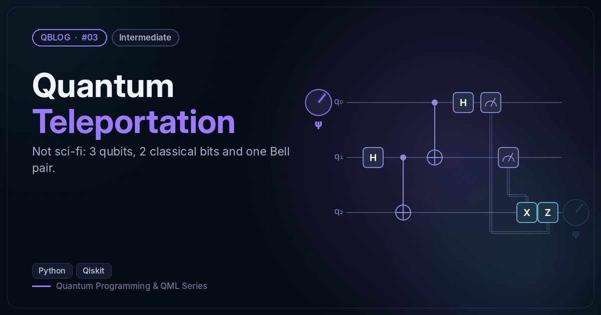

# #03 — Kuantum Işınlanma / Quantum Teleportation

 

🇹🇷 Rastgele bir durumu dinamik devreyle (ölçüm + klasik düzeltme) Bob'a ışınlar ve sadakati 1.0 olarak doğrular.
🇬🇧 Teleports a random state to Bob with a dynamic circuit (measurement + classical correction) and verifies fidelity 1.0.

```bash
python teleportation.py
```

**Örnek çıktı / Sample output**

```
Gizli durum / Secret state: θ=0.269, φ=1.488
Bob P(1) ölçülen / measured: 0.019   beklenen / expected: 0.018
Sadakat / Fidelity(Alice → Bob): 1.0
```
