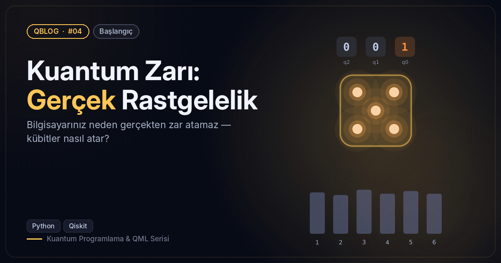
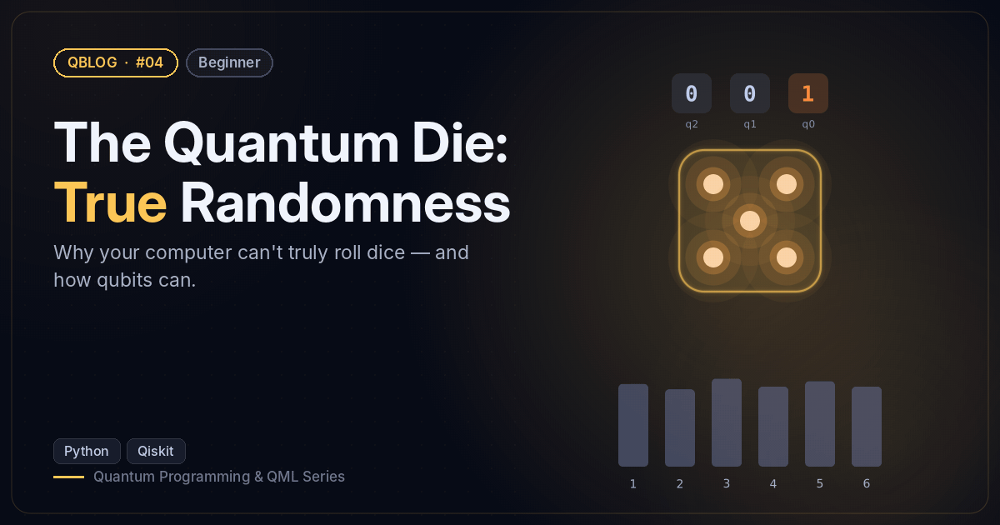

# #04 — Kuantum Zarı: Gerçek Rastgelelik / The Quantum Die: True Randomness

 

🇹🇷 3 kübitle 0–7 üretir, reddetme örneklemesiyle adil bir zar yapar ve χ² testiyle adilliği ölçer.
🇬🇧 Draws 0–7 from 3 qubits, builds a fair die by rejection sampling and checks fairness with a χ² test.

```bash
python quantum_dice.py
```

**Örnek çıktı / Sample output**

```
                 0  1  2 
Beş zar / Five rolls: [3, 2, 3, 4, 4]
6000 atış / rolls:
  1: ███████████████████████ 945
  2: █████████████████████████ 1028
  3: ████████████████████████ 996
  4: ██████████████████████████ 1056
  5: ████████████████████████ 980
  6: ████████████████████████ 995
χ² = 7.39  (5 serbestlik derecesi, %95 sınırı ≈ 11.07 / 5 dof, 95% limit ≈ 11.07)
```
