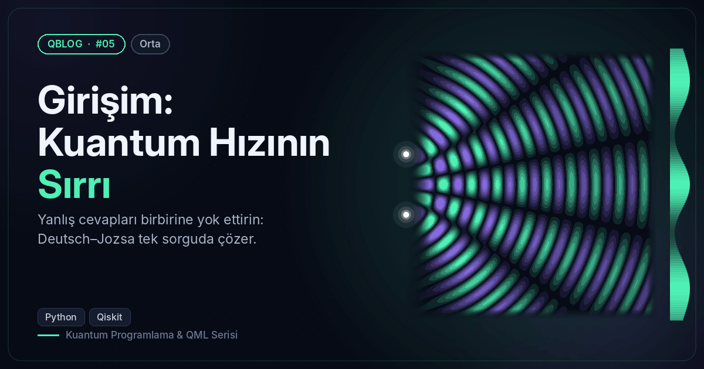
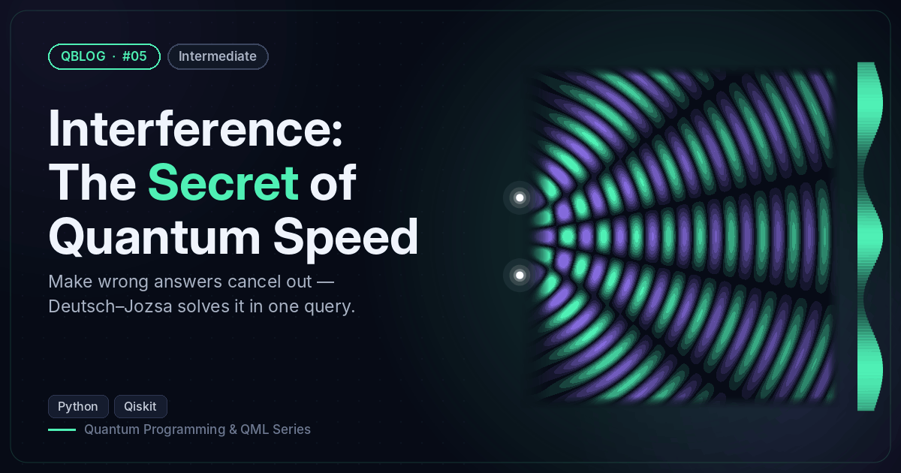

# #05 — Girişim: Kuantum Hızının Sırrı / Interference: The Secret of Quantum Speed

 

🇹🇷 Deutsch–Jozsa: sabit ve dengeli kâhinleri tek sorguda ayırt eder.
🇬🇧 Deutsch–Jozsa: tells constant and balanced oracles apart with a single query.

```bash
python deutsch_jozsa.py
```

**Örnek çıktı / Sample output**

```
                     0   2             1  3 
Kâhin / Oracle                 | Sonuç / Result | Karar / Verdict
sabit/const=0                  |      0000      | SABİT / CONSTANT
sabit/const=1                  |      0000      | SABİT / CONSTANT
dengeli/balanced m=1010        |      1010      | DENGELİ / BALANCED
dengeli/balanced m=0111        |      0111      | DENGELİ / BALANCED
dengeli/balanced m=1111        |      1111      | DENGELİ / BALANCED
TR: Dengeli kâhinlerde ölçüm sonucu gizli maskenin ta kendisi (Bernstein–Vazirani'nin tohumu).
EN: For balanced oracles the result IS the hidden mask (the seed of Bernstein–Vazirani).
```
