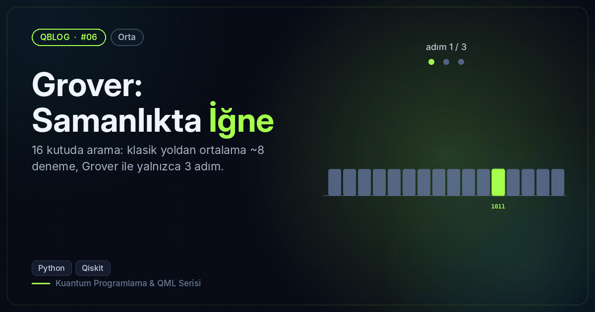
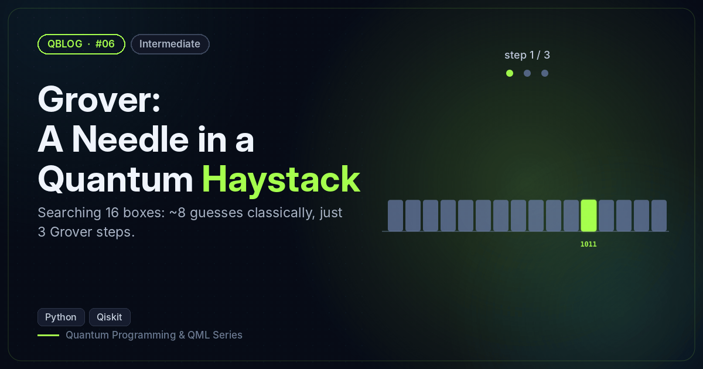

# #06 — Grover: Samanlıkta İğne / Grover: A Needle in a Quantum Haystack

 

🇹🇷 16 eleman arasında 1011'i Grover ile 3 adımda ~%96 olasılıkla bulur; adım adım olasılığı yazdırır.
🇬🇧 Finds 1011 among 16 items in 3 Grover steps with ~96% probability and prints the probability per step.

```bash
python grover_search.py
```

**Örnek çıktı / Sample output**

```
N = 16, en iyi adım sayısı / optimal iterations = 3
Adım / Iter | P(hedef / target)
          0 | 0.062 ██
          1 | 0.473 ██████████████████
          2 | 0.908 ████████████████████████████████████
          3 | 0.961 ██████████████████████████████████████
          4 | 0.582 ███████████████████████
          5 | 0.125 █████
1000 ölçümde en sık / most frequent: [('1011', 958), ('1111', 5), ('0000', 4)]
```
