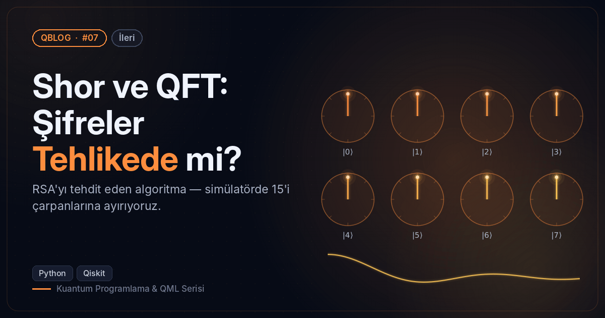
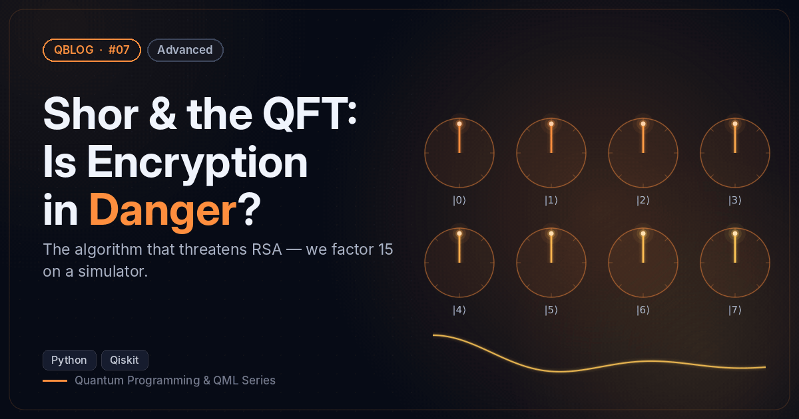

# #07 — Shor ve QFT: Şifreler Tehlikede mi? / Shor & the QFT: Is Encryption in Danger?

 

🇹🇷 Elle kurulmuş ters QFT ve 7^x mod 15 ile periyodu bulur, 15 = 3 × 5 çarpanlarını çıkarır.
🇬🇧 Uses a hand-built inverse QFT and 7^x mod 15 to find the period and recover 15 = 3 × 5.

```bash
python shor_15.py
```

**Örnek çıktı / Sample output**

```
Ölçüm | Faz / Phase | Tahmini periyot r / Guessed period r
00000000 |  0.000      | r = 1   (529 kez / times)
01000000 |  0.250      | r = 4   (519 kez / times)
11000000 |  0.750      | r = 4   (503 kez / times)
10000000 |  0.500      | r = 2   (497 kez / times)
Periyot / Period of 7^x mod 15: r = 4  (7, 4, 13, 1, 7, …)
Bulunan çarpanlar / Factors found: [3, 5]  → 15 = 3 × 5
```
