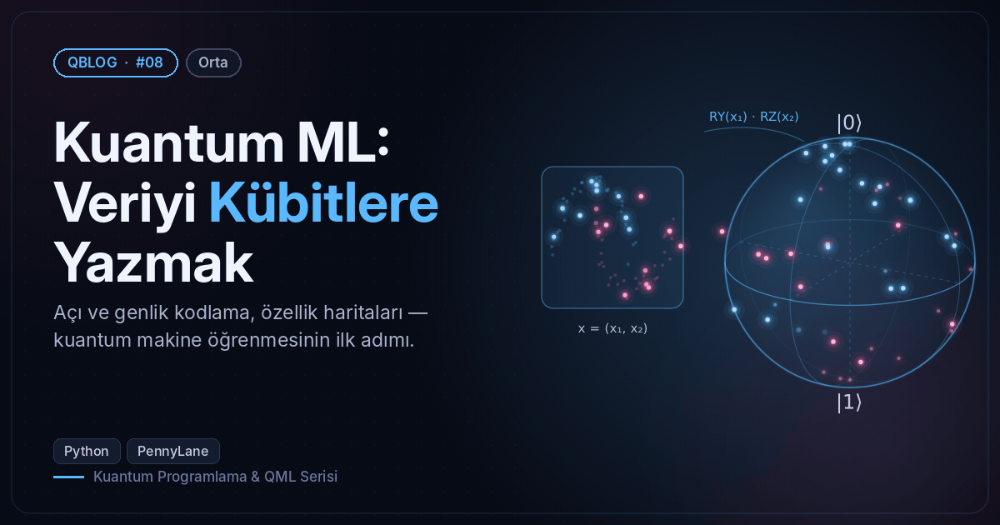
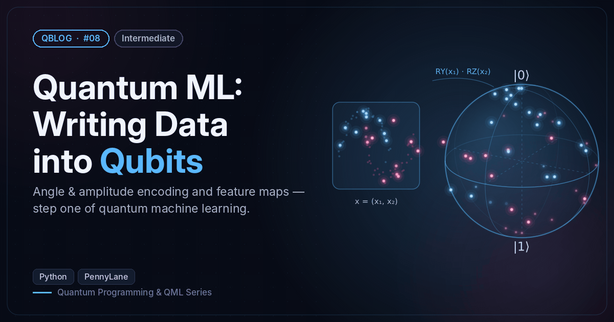

# #08 — Kuantum ML: Veriyi Kübitlere Yazmak / Quantum ML: Writing Data into Qubits

 

🇹🇷 Açı, genlik ve ZZ özellik haritası kodlamalarını karşılaştırır; moons verisini Bloch küresine yerleştirir.
🇬🇧 Compares angle, amplitude and ZZ feature-map encodings and places the moons dataset on the Bloch sphere.

```bash
python data_encoding.py
```

**Örnek çıktı / Sample output**

```
Açı kodlama / Angle encoding  x = [0.8 2.1]
  Bloch (x, y, z): [-0.362  0.619  0.697]
Genlik kodlama / Amplitude encoding: [3. 1. 4. 1. 5. 9. 2. 6.]
  genlikler / amplitudes: [0.228 0.076 0.304 0.076 0.38  0.684 0.152 0.456]
  olasılıklar ∝ veri² / probabilities ∝ data²: [0.052 0.006 0.092 0.006 0.145 0.468 0.023 0.208]
ZZ özellik haritası / ZZ feature map — kuantum benzerlik / quantum similarity
  yakın noktalar / nearby points  F(a,b) = 0.917
  uzak noktalar  / distant points F(a,c) = 0.020
  TR: Bu benzerlik #10'daki kuantum çekirdeğinin ta kendisi.
  EN: This similarity is exactly the quantum kernel of post #10.
Görsel / Figure → /home/claude/QBlog/08-qml-encoding/output/08_moons_on_bloch.png
```
