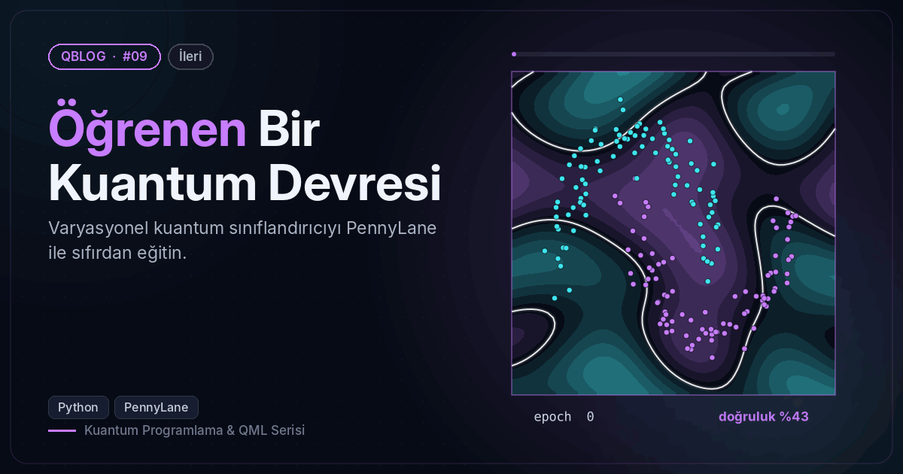
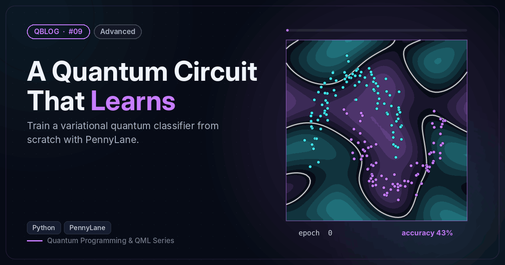

# #09 — Öğrenen Bir Kuantum Devresi / A Quantum Circuit That Learns

 

🇹🇷 2 kübitlik, veriyi yeniden yükleyen bir varyasyonel sınıflandırıcıyı Adam ile eğitir (~%97 test doğruluğu).
🇬🇧 Trains a 2-qubit data re-uploading variational classifier with Adam (~97% test accuracy).

```bash
python vqc_moons.py
```

**Örnek çıktı / Sample output**

```
epoch   1 | kayıp/loss 0.646 | eğitim/train 76.67% | test 73.33%
epoch   5 | kayıp/loss 0.220 | eğitim/train 94.44% | test 96.67%
epoch  10 | kayıp/loss 0.200 | eğitim/train 95.00% | test 96.67%
epoch  15 | kayıp/loss 0.186 | eğitim/train 95.56% | test 96.67%
epoch  20 | kayıp/loss 0.151 | eğitim/train 97.22% | test 98.33%
epoch  25 | kayıp/loss 0.124 | eğitim/train 98.33% | test 98.33%
epoch  30 | kayıp/loss 0.123 | eğitim/train 98.89% | test 98.33%
epoch  35 | kayıp/loss 0.106 | eğitim/train 97.78% | test 98.33%
epoch  40 | kayıp/loss 0.105 | eğitim/train 97.22% | test 96.67%
Görsel / Figure → /home/claude/QBlog/09-variational-classifier/output/09_decision_boundary.png
```
