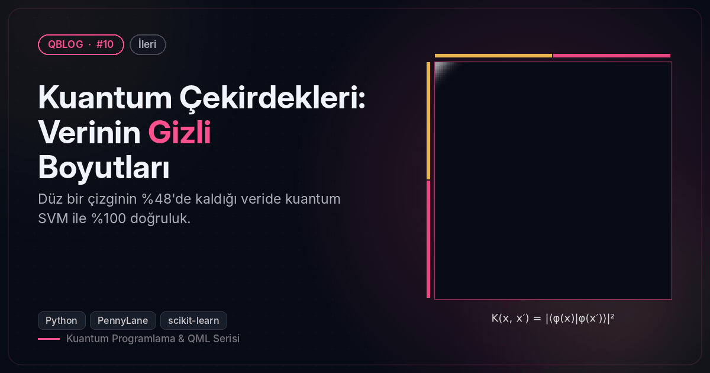
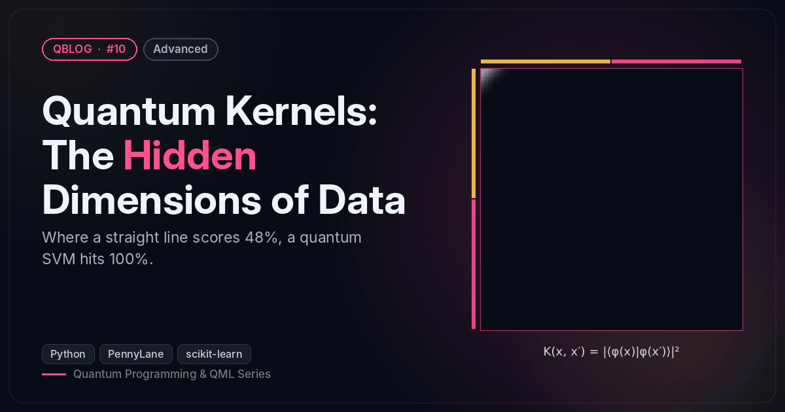

# #10 — Kuantum Çekirdekleri: Verinin Gizli Boyutları / Quantum Kernels: The Hidden Dimensions of Data

 

🇹🇷 Kuantum çekirdek matrisi hesaplar ve SVM'e verir: halkalarda %100, doğrusal SVM ise ~%48.
🇬🇧 Computes a quantum kernel matrix for an SVM: 100% on rings vs ~48% for a linear SVM.

```bash
python quantum_kernel_svm.py
```

**Örnek çıktı / Sample output**

```
k(x0, x1) devre/circuit = 0.0482 | durum/statevector = 0.0482
QSVM test doğruluğu / accuracy:          100.00%
Doğrusal SVM / Linear SVM (karşılaştırma): 47.92%
TR: Halkalar düz bir çizgiyle ayrılamaz; kuantum çekirdeği ayırır.
EN: Rings can't be split by a straight line; the quantum kernel can.
Görsel / Figure → /home/claude/QBlog/10-quantum-kernels/output/10_qsvm.png
```
