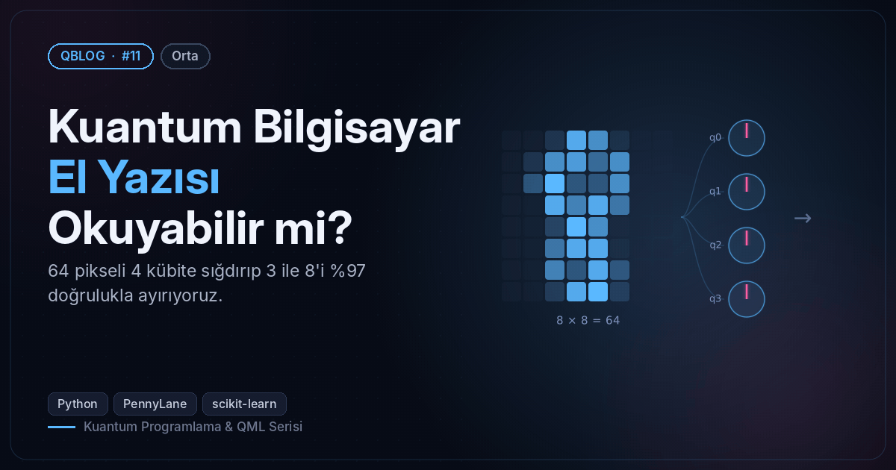
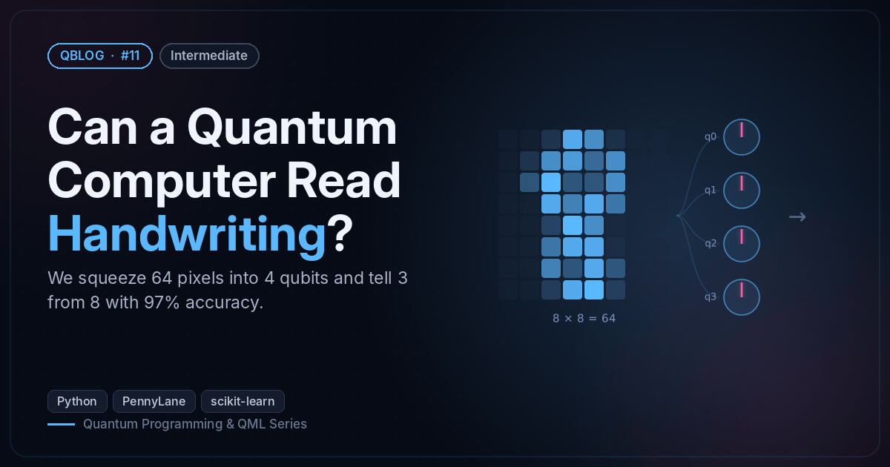

# #11 — Kuantum Bilgisayar El Yazısı Okuyabilir mi? / Can a Quantum Computer Read Handwriting?

 

🇹🇷 El yazısı rakamları PCA ile 4 sayıya indirip 4 kübitlik varyasyonel devreyle 3 ile 8'i ayırt eder (~%97 test doğruluğu).
🇬🇧 Compresses handwritten digits to 4 numbers with PCA and tells 3 from 8 with a 4-qubit variational circuit (~97% test accuracy).

```bash
python quantum_digits.py
```

**Örnek çıktı / Sample output**

```
Eğitim / train: 267  test: 90  |  PCA 4 bileşen varyansın %52'sini tutuyor / keeps 52% of the variance
epoch  1 | kayıp/loss 0.480 | eğitim/train 94.0% | test 95.6%
epoch  5 | kayıp/loss 0.283 | eğitim/train 96.6% | test 95.6%
epoch 10 | kayıp/loss 0.288 | eğitim/train 95.1% | test 97.8%
epoch 15 | kayıp/loss 0.248 | eğitim/train 97.0% | test 95.6%
epoch 20 | kayıp/loss 0.227 | eğitim/train 97.4% | test 96.7%
epoch 25 | kayıp/loss 0.239 | eğitim/train 96.3% | test 97.8%
Görsel / Figure → /home/claude/QBlog/11-qml-digits/output/11_predictions.png
```
