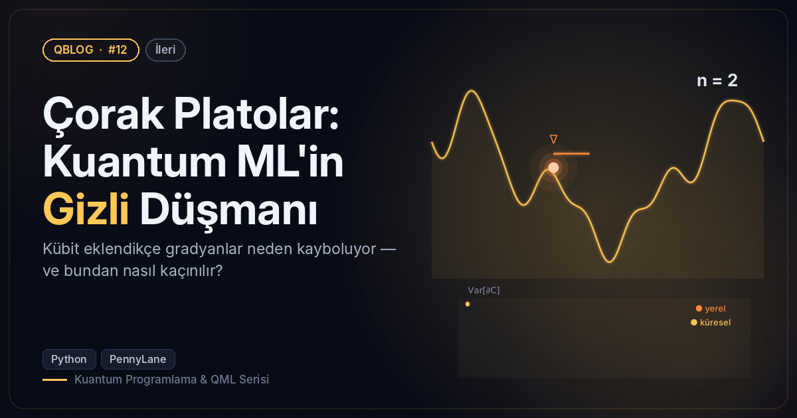
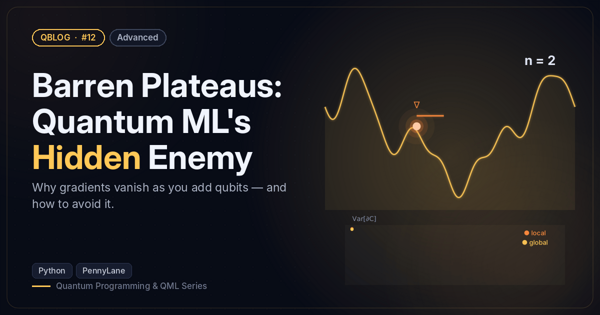

# #12 — Çorak Platolar: Kuantum ML'in Gizli Düşmanı / Barren Plateaus: Quantum ML's Hidden Enemy

 

🇹🇷 Rastgele devrelerde gradyan varyansının kübit sayısıyla üstel küçüldüğünü ölçer; küresel ve yerel maliyeti karşılaştırır.
🇬🇧 Measures how gradient variance shrinks exponentially with qubit count in random circuits; compares global vs local costs.

```bash
python barren_plateaus.py
```

**Örnek çıktı / Sample output**

```
 kübit/qubits | Var[∂C] küresel/global | Var[∂C] yerel/local
           2 |               8.39e-02 |            8.90e-02
           3 |               4.27e-02 |            6.52e-02
           4 |               2.21e-02 |            8.31e-02
           5 |               9.98e-03 |            6.91e-02
           6 |               4.45e-03 |            5.30e-02
           7 |               1.67e-03 |            4.54e-02
           8 |               9.05e-04 |            5.70e-02
           9 |               4.43e-04 |            4.36e-02
          10 |               4.09e-04 |            4.42e-02
Küresel maliyette her yeni kübit varyansı ~2.1 kat küçültüyor.
Global cost: each extra qubit shrinks the variance by ~2.1x.
Görsel / Figure → /home/claude/QBlog/12-barren-plateaus/output/12_barren_plateau.png
```
