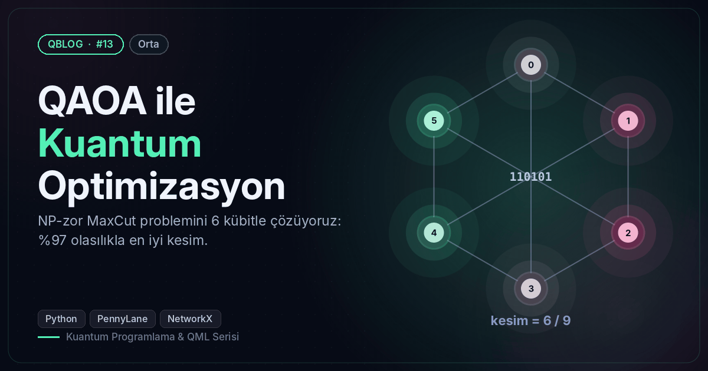
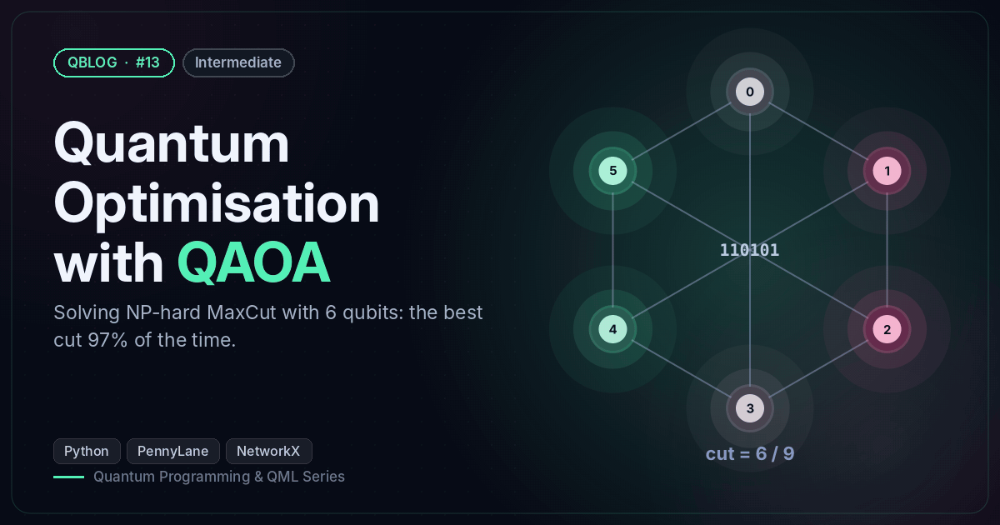

# #13 — QAOA ile Kuantum Optimizasyon / Quantum Optimisation with QAOA

 

🇹🇷 6 düğümlü bir grafta MaxCut'ı QAOA (p=3) ile çözer ve kaba kuvvetle karşılaştırır (%97 olasılıkla en iyi kesim).
🇬🇧 Solves MaxCut on a 6-node graph with QAOA (p=3) and checks against brute force (best cut with 97% probability).

```bash
python qaoa_maxcut.py
```

**Örnek çıktı / Sample output**

```
Graf: 6 düğüm, 9 kenar | kaba kuvvet en iyi kesim / brute-force best cut = 9
adım/step   1 | beklenen kesim / expected cut = 3.127
adım/step  25 | beklenen kesim / expected cut = 7.872
adım/step  50 | beklenen kesim / expected cut = 8.230
adım/step 100 | beklenen kesim / expected cut = 8.852
adım/step 150 | beklenen kesim / expected cut = 8.858
En sık ölçülen bölmeler / Most frequent partitions:
  101010  kesim/cut = 9  (48.6%)
  010101  kesim/cut = 9  (48.5%)
  000000  kesim/cut = 0  (0.3%)
  111111  kesim/cut = 0  (0.3%)
Optimal çözümü bulma olasılığı / probability of an optimal cut: 97.1%
Rastgele tahminle / random guess: 3.1%
Görsel / Figure → /home/claude/QBlog/13-qaoa-maxcut/output/13_maxcut.png
```
