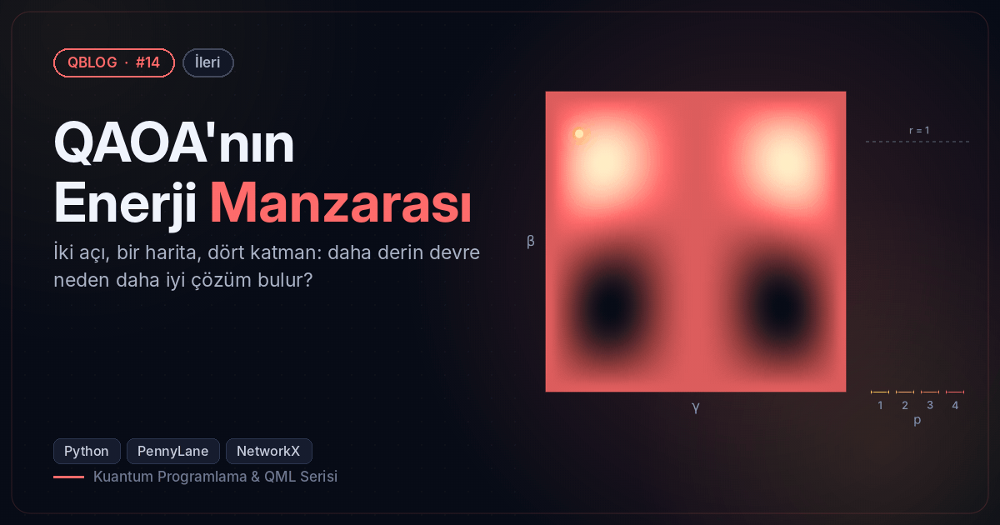
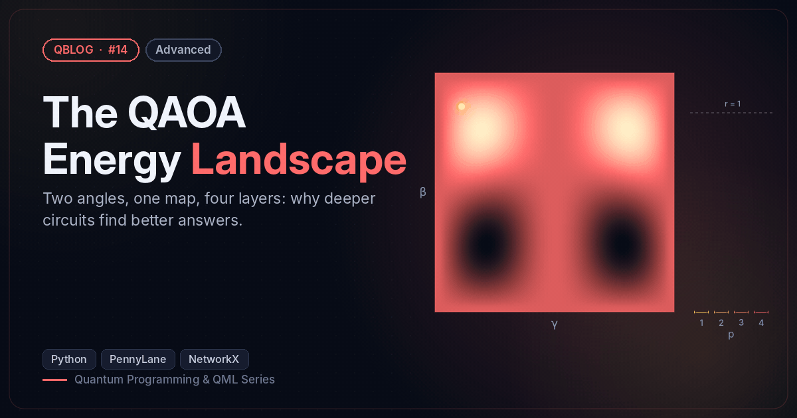

# #14 — QAOA'nın Enerji Manzarası / The QAOA Energy Landscape

 

🇹🇷 p=1 QAOA enerji manzarasını haritalar, p=1..4 için yaklaşıklık oranını ölçer ve açı aktarımını dener.
🇬🇧 Maps the p=1 QAOA energy landscape, measures the approximation ratio for p=1..4 and tests parameter transfer.

```bash
python qaoa_landscape.py
```

**Örnek çıktı / Sample output**

```
3-düzenli graf / 3-regular graph: 8 düğüm/nodes, 12 kenar/edges, en iyi kesim / best cut = 10
p=1 ızgara taraması / grid scan: en iyi / best γ=2.59, β=1.22, kesim/cut = 8.000  (oran / ratio r = 0.800)
 p | beklenen kesim / expected cut | yaklaşıklık oranı / approximation ratio
 1 |                         8.007 | 0.801
 2 |                         8.784 | 0.878
 3 |                         9.361 | 0.936
 4 |                         9.627 | 0.963
Açı aktarımı / transfer → 12 düğüm: kesim/cut = 13.389, oran / ratio = 0.837  (yeniden optimizasyon yok / no re-optimisation)
Görsel / Figure → /home/claude/QBlog/14-qaoa-landscape/output/14_qaoa_landscape.png
```
