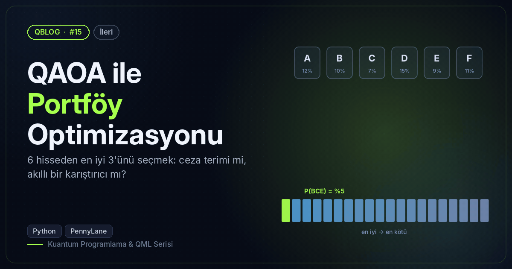
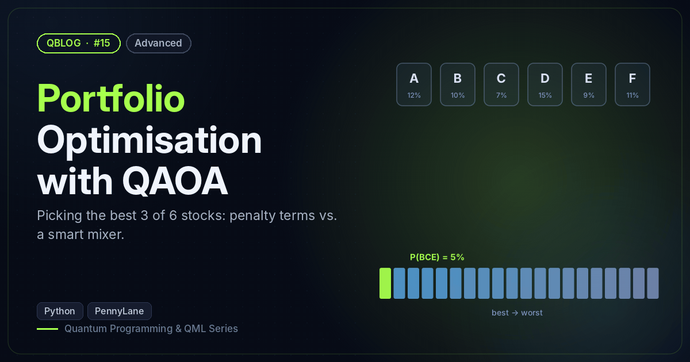

# #15 — QAOA ile Portföy Optimizasyonu / Portfolio Optimisation with QAOA

 

🇹🇷 6 hisseden 3'ünü seçen portföy problemini QUBO → Ising'e çevirir; ceza terimi ile XY karıştırıcıyı karşılaştırır. (Veriler hayalîdir, yatırım tavsiyesi değildir.)
🇬🇧 Turns a pick-3-of-6-stocks portfolio problem into QUBO → Ising and compares a penalty term with an XY mixer. (Made-up data, not investment advice.)

```bash
python qaoa_portfolio.py
```

**Örnek çıktı / Sample output**

```
20 geçerli portföy / valid portfolios. Kaba kuvvet en iyisi / brute-force best: BCE  (amaç/objective = -0.1331)
İlk 3 / Top 3: BCE (-0.1331), CEF (-0.1319), ACE (-0.1245)
Ceza terimi / Penalty + X mixer
  geçerli (tam 3) olasılığı / P(valid): 96.2%
  en iyi portföy olasılığı / P(best):    4.0%   (rastgele geçerli / random valid: 5.0%)
   100101  ADF    6.0%
   110100  ABD    5.7%
   010101  BDF    5.7%
XY karıştırıcı / XY mixer
  geçerli (tam 3) olasılığı / P(valid): 100.0%
  en iyi portföy olasılığı / P(best):    24.2%   (rastgele geçerli / random valid: 5.0%)
   011010  BCE    24.2%
   001011  CEF    23.6%
   101010  ACE    18.0%
Görsel / Figure → /home/claude/QBlog/15-qaoa-portfolio/output/15_portfolio.png
```
