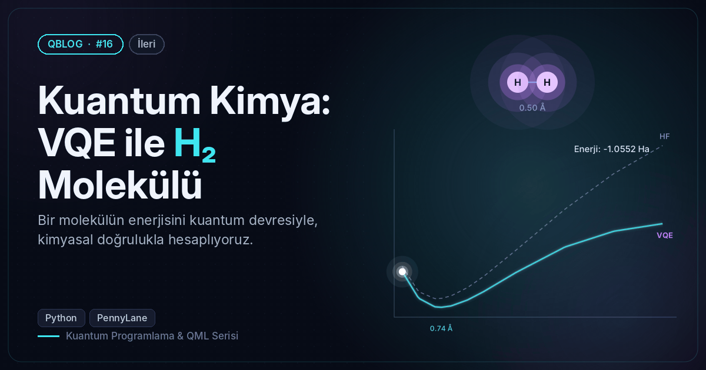
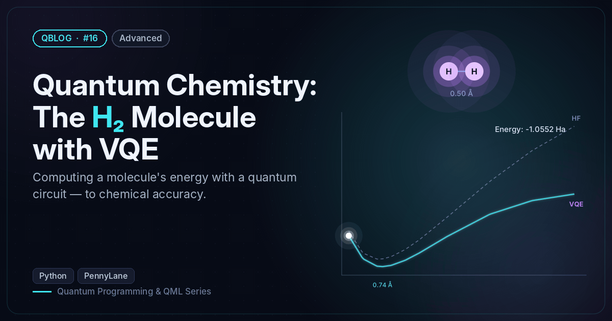

# #16 — Kuantum Kimya: VQE ile H₂ Molekülü / Quantum Chemistry: The H₂ Molecule with VQE

 

🇹🇷 H₂ molekülünün temel durum enerjisini VQE ile hesaplar ve bağ uzunluğuna göre enerji eğrisini tam çözümle karşılaştırır.
🇬🇧 Computes the H₂ ground-state energy with VQE and compares the bond-length energy curve with the exact answer.

```bash
python vqe_h2.py
```

**Örnek çıktı / Sample output**

```
H₂ @ 0.74 Å → 4 kübit / qubits, Hamiltonyen'de 15 terim / terms
Hartree–Fock : -1.116759 Ha
VQE          : -1.137284 Ha   (θ = 0.2256)
Tam / Exact  : -1.137284 Ha
Hata / Error : 2.79e-13 kcal/mol (kimyasal doğruluk / chemical accuracy < 1.6)
 d (Å) |   HF (Ha)  |  VQE (Ha)  | Tam/Exact (Ha)
  0.50 | -1.04300 | -1.05516 | -1.05516
  0.60 | -1.10113 | -1.11629 | -1.11629
  0.70 | -1.11735 | -1.13619 | -1.13619
  0.74 | -1.11676 | -1.13728 | -1.13728
  0.80 | -1.11085 | -1.13415 | -1.13415
  0.90 | -1.09191 | -1.12056 | -1.12056
  1.00 | -1.06611 | -1.10115 | -1.10115
  1.20 | -1.00511 | -1.05674 | -1.05674
  1.50 | -0.91087 | -0.99815 | -0.99815
  1.80 | -0.82885 | -0.96182 | -0.96182
  2.10 | -0.76418 | -0.94437 | -0.94437
En düşük enerji / Minimum energy at d ≈ 0.74 Å (deneysel / experiment: 0.74 Å)
Görsel / Figure → /home/claude/QBlog/16-vqe-h2/output/16_h2_curve.png
```
