# QBlog ⚛️ — Kuantum Programlama & Kuantum Makine Öğrenmesi / Quantum Programming & QML

🇹🇷 Blog serisinin tüm örnek kodları. Her klasör bir yazıya karşılık gelir; kodlar tek başına çalışır ve çıktılarını terminale ve `output/` klasörüne yazar.
🇬🇧 All example code for the blog series. Each folder matches one post; every script runs on its own and writes results to the terminal and to `output/`.

## Seri / Series

| # | Kapak / Cover | 🇹🇷 Yazı | 🇬🇧 Post | Kod / Code |
|---|---|---|---|---|
| 01 | 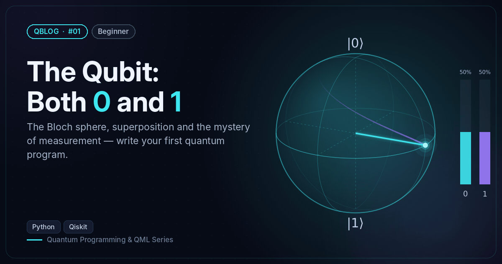 | Kübit: Hem 0 Hem 1 | The Qubit: Both 0 and 1 | [`01-qubit`](01-qubit) |
| 02 | 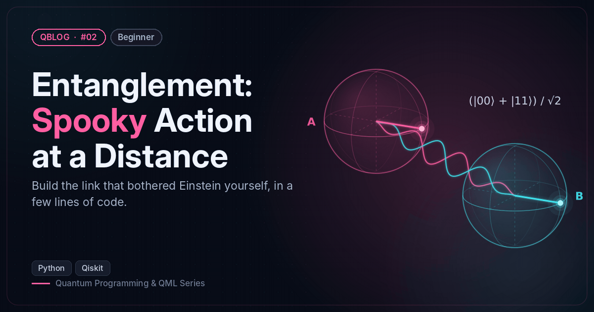 | Dolanıklık: Ürkütücü Uzaktan Etki | Entanglement: Spooky Action at a Distance | [`02-entanglement`](02-entanglement) |
| 03 | 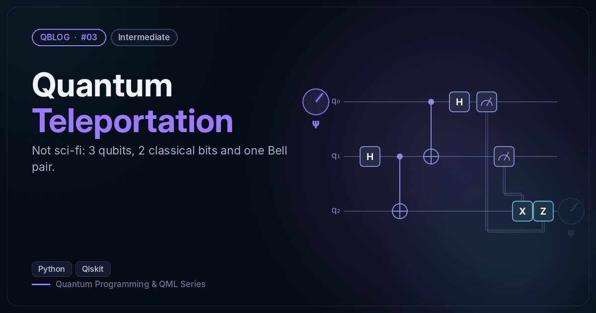 | Kuantum Işınlanma | Quantum Teleportation | [`03-teleportation`](03-teleportation) |
| 04 | 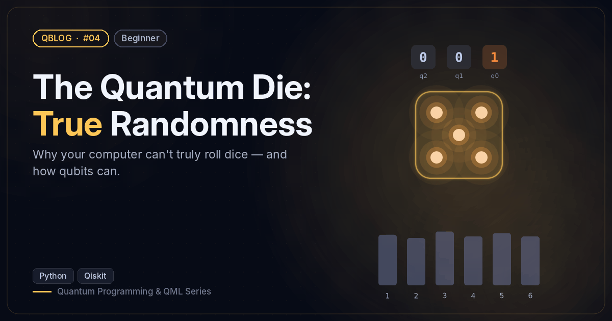 | Kuantum Zarı: Gerçek Rastgelelik | The Quantum Die: True Randomness | [`04-quantum-random`](04-quantum-random) |
| 05 | 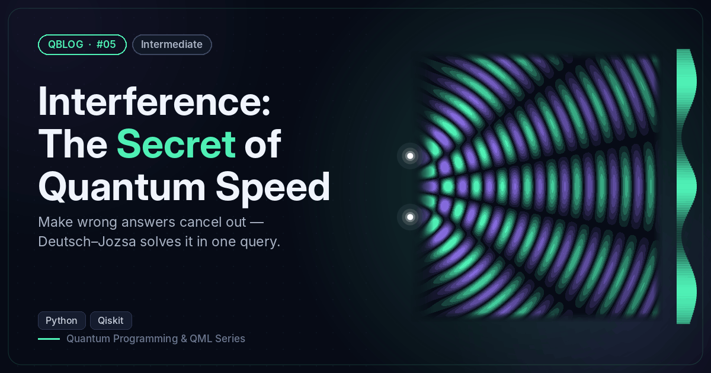 | Girişim: Kuantum Hızının Sırrı | Interference: The Secret of Quantum Speed | [`05-interference`](05-interference) |
| 06 | 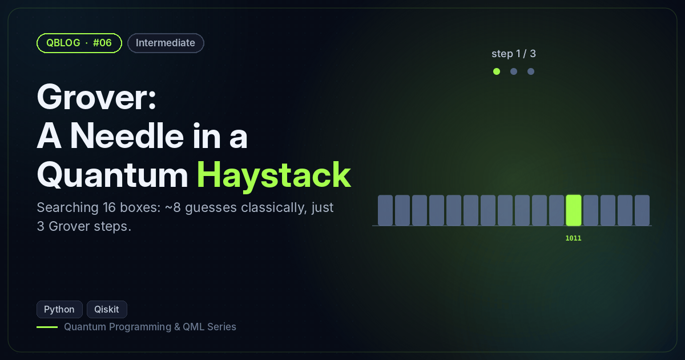 | Grover: Samanlıkta İğne | Grover: A Needle in a Quantum Haystack | [`06-grover`](06-grover) |
| 07 | 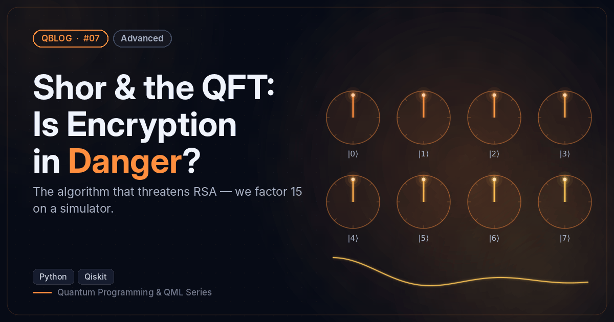 | Shor ve QFT: Şifreler Tehlikede mi? | Shor & the QFT: Is Encryption in Danger? | [`07-shor-qft`](07-shor-qft) |
| 08 | 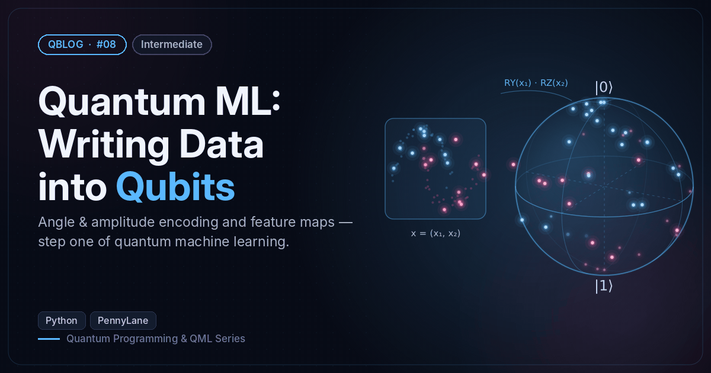 | Kuantum ML: Veriyi Kübitlere Yazmak | Quantum ML: Writing Data into Qubits | [`08-qml-encoding`](08-qml-encoding) |
| 09 | 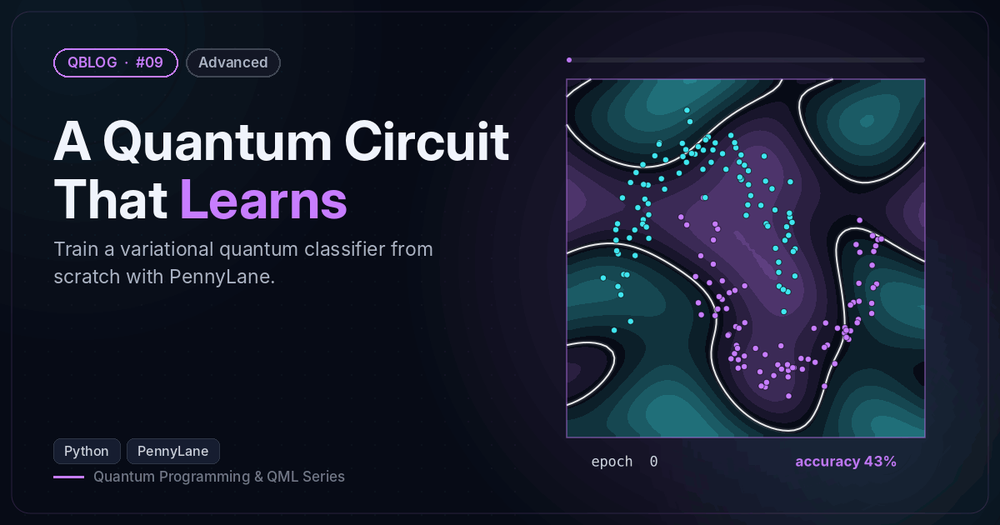 | Öğrenen Bir Kuantum Devresi | A Quantum Circuit That Learns | [`09-variational-classifier`](09-variational-classifier) |
| 10 | 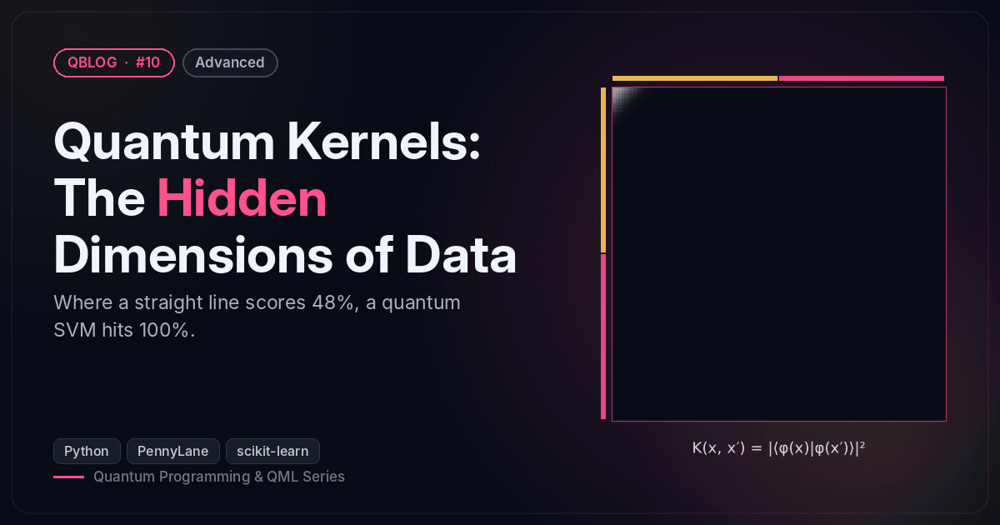 | Kuantum Çekirdekleri: Verinin Gizli Boyutları | Quantum Kernels: The Hidden Dimensions of Data | [`10-quantum-kernels`](10-quantum-kernels) |
| 11 | 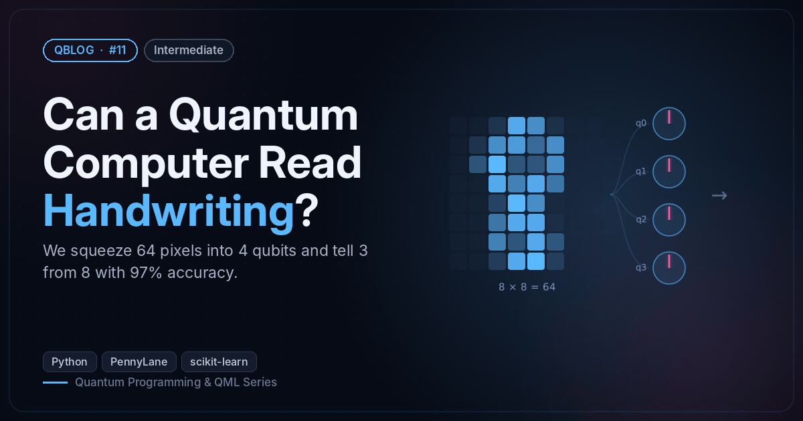 | Kuantum Bilgisayar El Yazısı Okuyabilir mi? | Can a Quantum Computer Read Handwriting? | [`11-qml-digits`](11-qml-digits) |
| 12 | 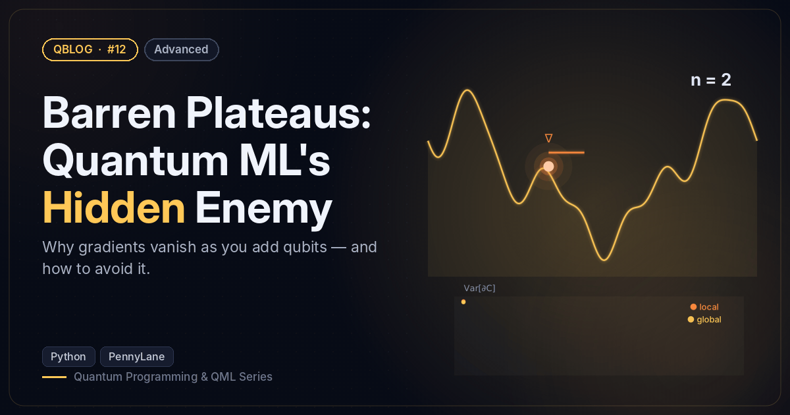 | Çorak Platolar: Kuantum ML'in Gizli Düşmanı | Barren Plateaus: Quantum ML's Hidden Enemy | [`12-barren-plateaus`](12-barren-plateaus) |
| 13 | 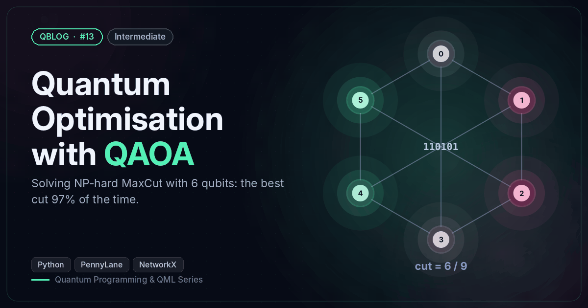 | QAOA ile Kuantum Optimizasyon | Quantum Optimisation with QAOA | [`13-qaoa-maxcut`](13-qaoa-maxcut) |
| 14 | 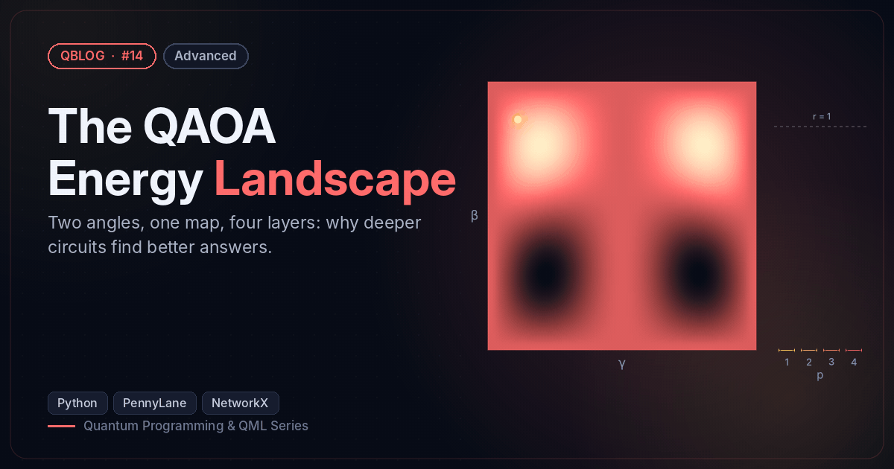 | QAOA'nın Enerji Manzarası | The QAOA Energy Landscape | [`14-qaoa-landscape`](14-qaoa-landscape) |
| 15 | 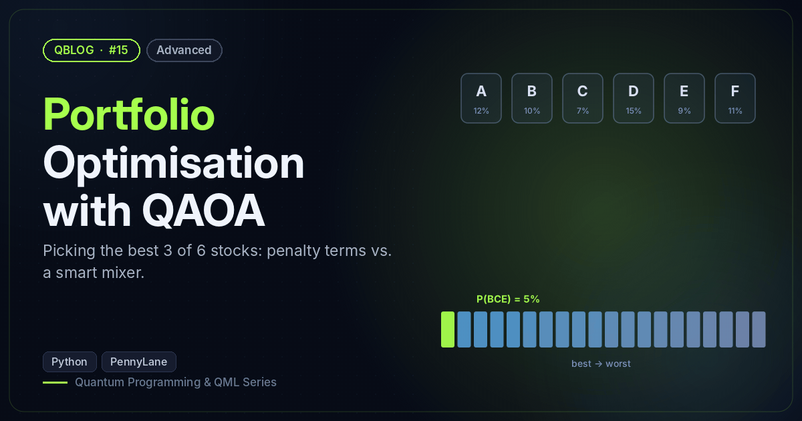 | QAOA ile Portföy Optimizasyonu | Portfolio Optimisation with QAOA | [`15-qaoa-portfolio`](15-qaoa-portfolio) |
| 16 | 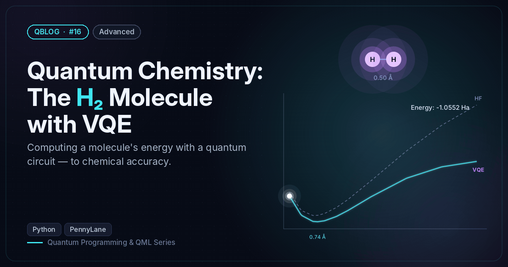 | Kuantum Kimya: VQE ile H₂ Molekülü | Quantum Chemistry: The H₂ Molecule with VQE | [`16-vqe-h2`](16-vqe-h2) |

## Kurulum / Setup

```bash
git clone https://github.com/SevdanurGENC/Quantum-Blog-Series.git
cd Quantum-Blog-Series
python -m venv .venv && source .venv/bin/activate      # Windows: .venv\Scripts\activate
pip install -r requirements.txt
```

## Çalıştırma / Run

```bash
cd 06-grover
python grover_search.py
```

🇹🇷 Python 3.10+ önerilir. #01–#07 Qiskit, #08–#16 PennyLane kullanır. Hepsi dizüstü bilgisayarda en fazla bir iki dakikada çalışır.
🇬🇧 Python 3.10+ recommended. #01–#07 use Qiskit, #08–#16 use PennyLane. Everything runs on a laptop within a minute or two.

## Klasör yapısı / Layout

```
QBlog/
├── 01-qubit/ … 16-vqe-h2/           # her yazının kodu / code for each post
├── assets/
│   ├── covers/          # TR + EN kapak GIF'leri ve statik PNG'ler / cover GIFs + static PNGs
│   ├── covers_meta.py   # kapak başlıkları / cover titles
│   └── make_covers.py   # kapakları yeniden üret / regenerate covers
└── requirements.txt
```

🇹🇷 Kapaklar, yazılardaki gerçek sonuçlardan üretilir (ör. #09'daki karar sınırı, gerçek eğitimin her epoch'undan gelir). Yeniden üretmek için: `pip install -r assets/requirements-covers.txt && cd assets && python make_covers.py` (ffmpeg gerekir).
🇬🇧 Covers are generated from the posts' real results (e.g. the #09 decision boundary comes from each epoch of the actual training). To regenerate: `pip install -r assets/requirements-covers.txt && cd assets && python make_covers.py` (needs ffmpeg).
